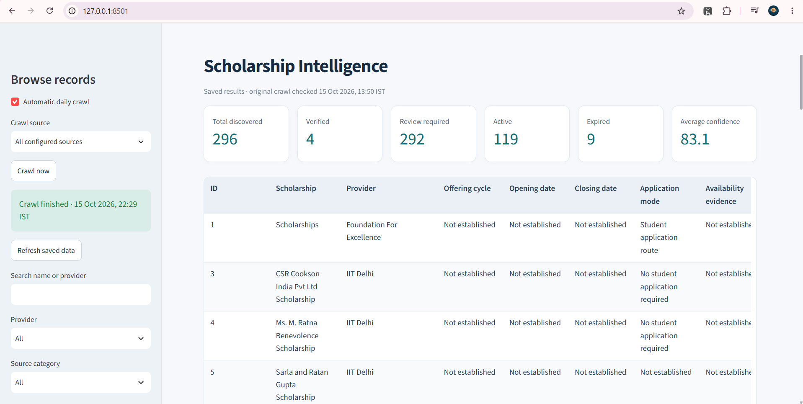
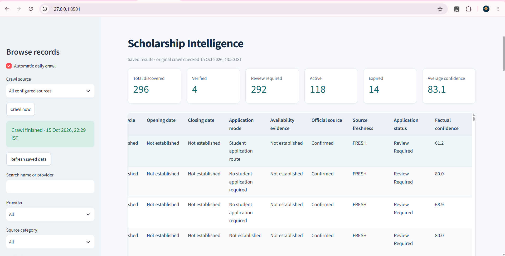
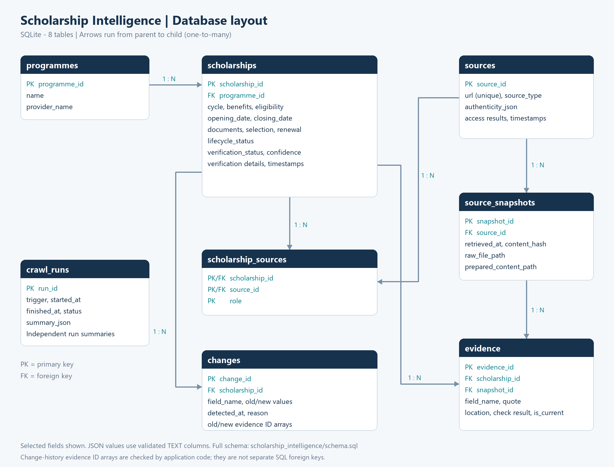

# Scholarship Intelligence Crawler

An automated scholarship crawler for Indian students. It discovers opportunities from official sources, extracts HTML/PDF content into a common schema, validates supporting evidence, calculates confidence, and maintains a searchable Streamlit dashboard.

The application uses Python rules. No API key, paid service, or language-model download is required.

## Quick start

Install **Python 3.11** and **uv**, then open the repository folder in a terminal:

```powershell
git clone https://github.com/Bhumi-codes/EDXSO-Assignment-2-Scholarship-Intelligence-Crawler.git
cd EDXSO-Assignment-2-Scholarship-Intelligence-Crawler
uv sync --locked
uv run python -m scholarship_intelligence start --no-crawl
```

If the repository is already downloaded, run only the last two commands from the folder containing `pyproject.toml`.

Open **http://127.0.0.1:8501**. Keep the terminal running. Stop the application with `Ctrl+C`.

The dashboard initially displays **296 genuine saved scholarship records**. 

## Dashboard preview



For installation without uv on Windows:

```powershell
python -m venv .venv
.venv\Scripts\python -m pip install -r requirements.txt
.venv\Scripts\python -m scholarship_intelligence start --no-crawl
```

On macOS/Linux, use `.venv/bin/python` in place of `.venv\Scripts\python`. Windows with Python 3.11 is the tested environment. Internet access is required for dependency installation and live crawling. Saved records can be viewed offline once dependencies are installed.

## Working demonstration guide

### 1. Start and browse

Run the Quick start command, then inspect the six dashboard metrics: **Total discovered, Verified, Review required, Active, Expired, and Average confidence**.

Search for a scholarship and open its details. Inspect available benefits, eligibility, documents, application dates, official source, application link, confidence explanation, source quotations, and change history. Missing or unsupported values remain unspecified or withheld. Awards and other excluded programme types are omitted from the main scholarship view.

### 2. Run a live crawl

Select a source in the sidebar and click **Crawl now**. Select **All configured sources** for the full workflow.




The background worker performs:

```text
Discover links -> Crawl official sources -> Prepare HTML/PDF
-> Extract fields -> Check evidence -> Calculate confidence
-> Store or flag for review -> Refresh dashboard
```

Progress and completion appear in the sidebar. Continue browsing saved records while the update runs. Website response times and source size determine live-crawl duration; a full run can take tens of minutes. The terminal remains open to serve the dashboard after **Crawl finished** appears.

### 3. Run again and inspect updates

Click **Crawl now** again. Every live run rechecks listing pages and known sources:

- ETag/Last-Modified validators allow conditional requests. A valid HTTP 304 reuses hash-checked saved bytes.
- When validators are unavailable, the page is downloaded and its hash compared.
- Unchanged content reuses extraction and independently validated evidence only while artifact hashes, configuration and processing rules still match.
- New or changed content is extracted and validated again. Accepted changes retain old/new values, timestamps and evidence; unresolved changes remain review proposals.
- Failed source access is recorded for re-verification rather than treated as proof of expiry.
- Date-based expiry, freshness and confidence are recalculated.

An unchanged result is a valid outcome. A live provider may not publish a revision between two demonstration runs.

### 4. Historical official-notice replay

**Objective of Historical Official-Notice Replay**

Demonstrate change and expiry detection using genuine official scholarship notices, without waiting for websites to publish new updates.

- Compare earlier and later notices to identify **two deadline changes**, retaining old/new values and source evidence.
- Evaluate published application windows at historical and current dates to demonstrate **two ACTIVE-to-EXPIRED transitions**.
- Keep replay results separate from the main scholarship database.

This demonstrates historical changes supported by official evidence; it does not claim that new changes were observed between live production crawls today.

Open a second terminal in the repository root, keeping the dashboard running:

```powershell
uv run python -m scholarship_intelligence replay-official-notices
```

This separate workflow fetches preserved official notices, validates deadline revisions, and evaluates historical application windows. It does not modify main-dashboard records.

The retained successful run on **15 October 2026 at 22:38 IST** produced:

- **NMMSS:** closing date changed from 30 September to 31 October 2026.
- **CSSS renewal, Sacred Heart College instructions:** closing date changed from 30 September to 31 October 2026.
- **Chevening India and DAAD HSK:** two historical ACTIVE-to-EXPIRED evaluations.
- **2 changed examples, 2 expired examples, no failures, target_met=true.**

See the [successful replay report](data/samples/official-replay-result.json) for quotations, official URLs, hashes, source locations and validation results. CSSS demonstrates an institutional instruction revision, not independently established national policy change. This is **historical official-notice replay**, not a new source change observed between production crawls today. The expiry examples advance the evaluation date across real published windows; source values are unchanged.


New replay output is stored in `data/runtime/official-notice-replay/latest.json`, with per-run reports, evidence and an isolated SQLite database. The retained sample JSON references the original local runtime artifacts; the JSON alone does not contain every referenced source file.

## Command-line workflows

Run all configured sources without starting the dashboard:

```powershell
uv run python -m scholarship_intelligence workflow-all
```

Run one complete source:

```powershell
uv run python -m scholarship_intelligence workflow --seed-id iit_delhi
```

Recover a stopped source workflow from saved crawl snapshots:

```powershell
uv run python -m scholarship_intelligence workflow --seed-id iit_delhi --resume
```

Resume is recovery from saved content, not a fresh source check. Omit `--resume` to fetch sources again.

Configured seeds in `config/seeds.json` are `ffe`, `iit_delhi`, `nsp`, `chevening_india`, and `hdfc_ecss`. They cover NGO/trust, university, government, international and corporate CSR sources. Relevant links and catalogue entries are discovered beyond the initial seed URLs. Source rules and crawl budgets constrain coverage; inaccessible or unlinked content is not guaranteed to be found.

**Automatic daily crawl** runs at **09:00 IST while the local dashboard server is running**, with a catch-up after a missed schedule. 

## Project structure
```text
EDXSO-Assignment-2-Scholarship-Intelligence-Crawler/
├── scholarship_intelligence/
│   ├── __init__.py              # Package metadata
│   ├── __main__.py              # Entry point for python -m
│   ├── bootstrap.py             # Restores saved database and evidence
│   ├── bundles.py               # Groups and validates source documents
│   ├── cli.py                   # Terminal commands
│   ├── comparison.py            # Compares extracted and stored facts
│   ├── confidence.py            # Confidence scoring and verification rules
│   ├── dashboard.py             # Streamlit dashboard
│   ├── evidence_validation.py   # Checks quotes, hashes and source locations
│   ├── http_cache.py            # Conditional requests and cached source bytes
│   ├── models.py                # Structured scholarship data models
│   ├── official_replay.py       # Historical official-notice replay
│   ├── pipeline.py              # Coordinates the complete workflow
│   ├── preparation.py           # Prepares HTML and PDF content
│   ├── preview.py               # Displays saved results during preparation
│   ├── progress.py              # Saves background workflow progress
│   ├── python_extraction.py     # Extracts scholarship fields using Python
│   ├── reuse.py                 # Reuses unchanged validated extractions
│   ├── schema.sql               # SQLite tables and constraints
│   ├── scholarship_storage.py   # Stores initial scholarship records
│   ├── semantic_assessment.py   # Assessment structure and validation
│   ├── settings.py              # Project paths and crawler settings
│   ├── snapshots.py             # Saves original source content
│   ├── source_profiles.py       # Source-specific parsing and grouping
│   ├── spider.py                # Crawl policies and link discovery
│   ├── storage.py               # Database initialization and connections
│   ├── updates.py               # Applies reviewed updates and retains history
│   └── workflow_service.py      # Background jobs and daily scheduling
│
├── config/
│   └── seeds.json               # Starting sources and discovery rules
│
├── data/
│   ├── samples/
│   │   ├── live-crawl-logs/     # Genuine retained crawl logs
│   │   ├── official-replay-result.json
│   │   ├── sample-scholarships.json
│   │   ├── saved-results.manifest.json
│   │   ├── saved-results.zip.part01
│   │   ├── saved-results.zip.part02
│   │   ├── saved-results.zip.part03
│   │   ├── saved-view.json.gz
│   │   └── validation-run.json
│   └── runtime/                 # Generated locally; excluded from Git
│
├── docs/
│   ├── technical-note.md
│   ├── release-checks.md
│   ├── dashboard.png
│   └── dashboard2.png
│
├── tests/
│   ├── test_cli.py
│   ├── test_comparison.py
│   ├── test_dashboard_workflows.py
│   ├── test_evidence_paths.py
│   ├── test_incremental.py
│   ├── test_official_replay.py
│   ├── test_pipeline.py
│   ├── test_python_extraction.py
│   └── test_updates.py
│
├── .github/
│   └── workflows/
│       └── tests.yml            # Automated test workflow
├── .streamlit/
│   └── config.toml              # Dashboard appearance/settings
├── .gitignore
├── .python-version
├── pyproject.toml
├── requirements.txt
├── uv.lock
└── README.md
```

## Technology stack

- **Python 3.11:** orchestration, deterministic extraction, evidence verification and confidence calculation.
- **Requests:** live HTTP retrieval and conditional requests.
- **Scrapy / Parsel:** link policies, HTML selection and document preparation.
- **pypdf:** text-PDF extraction with physical page references.
- **Pydantic:** common scholarship schema and validation.
- **SQLite:** transactional records, source associations, evidence and change history.
- **Streamlit:** dashboard, search, filters, crawl controls and record inspection.
- **uv:** locked dependency installation; `requirements.txt` also supports pip.
- **unittest:** isolated regression tests.
- **Windows OCR and Poppler:** optional scanned-notice processing in the historical replay.

## Database layout

The live database is **`data/runtime/scholarships.sqlite3`**. Its schema is [scholarship_intelligence/schema.sql](scholarship_intelligence/schema.sql), containing eight relational tables:

- **`programmes`:** continuing programme identity, scholarship name and provider.
- **`scholarships`:** offering cycle, benefits, eligibility, dates, documents, selection, renewal, lifecycle, verification, confidence and verification details.
- **`sources`:** source URLs, source types, authenticity and retrieval outcomes.
- **`scholarship_sources`:** links scholarships to primary, guideline, announcement, application or discovery sources.
- **`source_snapshots`:** retrieval timestamps, content hashes, and raw/prepared file paths for preserved source versions.
- **`evidence`:** field-level quotations, block/page locations, validation results and current/historical associations.
- **`changes`:** accepted old/new values, detection timestamps, reasons and old/new evidence references.
- **`crawl_runs`:** execution triggers, start/finish times, statuses and summaries.

  ## Database layout



**PK:** primary key · **FK:** foreign key · **UK:** unique key.

JSON-labelled fields are stored as validated SQLite `TEXT` columns. `crawl_runs` stores execution logs independently, without a direct foreign-key relationship to individual scholarships. Old/new evidence IDs in `changes` are JSON arrays validated by application logic.

One programme can have multiple scholarship offerings. Offerings link to multiple sources through `scholarship_sources`; sources have versioned snapshots. Evidence links an offering field to a specific snapshot. Changes retain references to old and new evidence. JSON columns hold structured benefits, eligibility and review details.

SQLite foreign keys and transactions protect relationships and updates. The schema enforces the minimum confidence and verification metadata for accepted `VERIFIED` rows. Application lifecycle is separate from verification: supported facts can describe an expired scholarship.

Raw/prepared source files, bundles, extraction packets and reports live beside the database under `data/runtime/`. Genuine saved records and their supporting artifacts are distributed in `data/samples/saved-results.zip.part01` through `part03`, with checksums in `saved-results.manifest.json`. Keep all parts together; the application restores them automatically. Generated runtime files and virtual environments are excluded from version control.

## Verification and confidence

Important claims must trace to official source evidence. Checks cover source association, immutable source hashes, exact quoted substrings, real field paths, source block/PDF page locations, field context and completeness of relevant cited passages. An official URL alone does not verify every scholarship fact.

```text
Confidence = 0.30 x official-source authenticity
           + 0.50 x supported applicable fields
           + 0.20 x dated offering context
```

Component scores are evaluated on a 0-100 scale. `VERIFIED` requires **confidence >=95 and all critical gates to pass**. Unsupported core identity, benefits or eligibility, missing required routing/supporting material, unresolved conflicts, or invalid freshness prevent verification. Source retrieval older than 30 days fails the freshness requirement.

**There is no artificial score floor or quota bonus. Missing facts are not invented.** Scores are deterministic evidence-based assessments, not calibrated probabilities of real-world correctness. Lifecycle statuses include `ACTIVE`, `EXPIRING_SOON`, `EXPIRED`, `REVIEW_REQUIRED`, and `NO_LONGER_VERIFIABLE`; unknown dates do not imply an open application window.

## Results

The retained genuine live validation run completed on **15 October 2026**, starting with an empty database. Its saved dashboard results were:

- **296 scholarship records**, with official-source identity confirmed for all 296.
- **4 verified / scoring at least 95**, and **292 review required**.
- **119 active or expiring-soon**, and **9 expired**.
- **83.1 average confidence**, rounded from 83.0588.
- **Five source categories** and **zero model/API calls**.

The separate historical replay subsequently passed with **2 changed and 2 expired examples**, with no failures and no changes to production rows.


## Tests

```powershell
uv run python -m unittest discover -s tests -v
```

Tests cover extraction, evidence matching, PDF page validation, confidence gates, conditional HTTP retrieval, cache invalidation, source failure handling, saved-result integrity, date preservation, duplicate prevention, change history, rollback and scheduler controls. Synthetic fixtures remain isolated from application data. Tests do not certify every external website's accuracy or future accessibility.

## Technical note

The **three-page technical note PDF** is included at [docs/technical-note.pdf](docs/technical-note.pdf) If showing unrendered at github, download it. It covers architecture, technology choices, discovery, extraction, verification, confidence methodology, anti-hallucination safeguards and change detection. An [editable Markdown version](docs/technical-note.md) is also available.


If port 8501 is occupied, use:

```powershell
uv run python -m scholarship_intelligence start --no-crawl --port 8502
```

## Limitations

- **Verification targets remain unmet:** All records are primary source verified but 4 records achieved whole-record verification with confidence ≥95%. This falls short of the required 10 records scoring ≥95%. 

- **Historical replay has a limited scope:** The two deadline changes and two expiry examples use genuine official notices and published windows. They do not demonstrate newly observed changes between two live production crawls.

- **PDF extraction has limits:** The normal workflow supports text PDFs. Scanned PDFs and complex tables may need additional processing; scanned-notice handling is implemented only for the separate replay.

- **Website coverage is not guaranteed:** Discovery depends on accessible links, configured source rules and crawl budgets. Blocked pages, JavaScript-only content and website layout changes can prevent extraction.

- **Automation requires the application to stay running:** Daily crawling works while the local dashboard server is active. It does not run when the computer or application is switched off.

- **Live updates can take time:** Large sources may require many page requests. Conditional requests and extraction reuse reduce repeated work, but checking for changes still requires contacting the sources.
